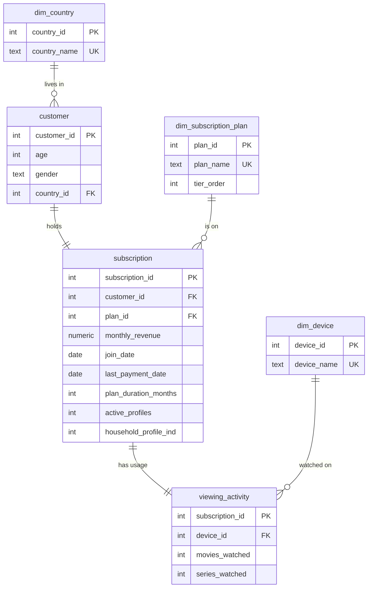

# Netflix Subscriptions – ELT pipeline (Inbank Data Engineer task)

An Airflow DAG loads `Netflix_dataset.csv` into SQLite using **ELT**. Python only moves the file into a raw table and orchestrates the steps. All transformations, quality checks and report queries are **SQL** files.

```
netflix_elt/
├── dags/
│   ├── netflix_elt_dag.py          # Airflow DAG (TaskFlow API)
│   ├── netflix_pipeline/tasks.py   # task functions (no Airflow imports → also runnable locally)
│   └── sql/
│       ├── 01_create_schema.sql    # raw, staging, normalized model, DQ tables
│       ├── 02_transform_staging.sql# typing, trimming, date parsing
│       ├── 03_quality_checks.sql   # CRITICAL / WARNING / INFO checks
│       ├── 04_load_model.sql       # idempotent upserts into the model
│       └── reports/                # answers to question 4 a–d
├── data/
│   ├── Netflix_dataset.csv         # source file (drop new files here)
│   ├── netflix.db                  # SQLite database (created by the pipeline)
│   └── reports/*.csv               # exported results of the 4 queries
├── run_local.py                    # same steps without Airflow
└── docker-compose.yaml             # one-container Airflow
```

## How to run

**With Airflow (Docker)**
```bash
echo "AIRFLOW_UID=$(id -u)" > .env        # Linux only: lets the container write to ./data
docker compose up -d
docker compose exec airflow cat /opt/airflow/standalone_admin_password.txt
```
Open http://localhost:8080 and log in as `admin` with that password. The DAG `netflix_subscriptions_elt` is unpaused and runs automatically. You can also trigger it with ▶. The results are written to `data/netflix.db` and `data/reports/`.

**Without Airflow**
```bash
python run_local.py
```

## DAG

```
wait_for_source_file → create_schema → extract_load_raw → transform_staging
   → data_quality_checks → load_model → report_a / report_b / report_c / report_d
```

| Step | What happens | Why |
|---|---|---|
| `wait_for_source_file` | Sensor waits until the file exists and its header matches. | The run does not fail just because the file arrives late. A changed file layout is caught before anything is loaded. |
| `extract_load_raw` | The CSV is copied 1:1 as TEXT into `raw_netflix_subscriptions`, with `batch_id`, `loaded_at`, file name and row number. | This is ELT: nothing is lost or changed on the way in. The raw layer keeps history, so any batch can be audited or reprocessed. |
| `transform_staging` | SQL trims values, casts types, converts `dd.mm.yyyy` to ISO dates and parses `"1 Month"` → `1`. | A value is cast only if it really is numeric. SQLite would otherwise silently turn `'abc'` into `0`. Bad values become NULL, so the checks can catch them. |
| `data_quality_checks` | 17 SQL checks are run and stored in `dq_check_results`. Any failed CRITICAL check fails the task, with no retry. | A bad file must never reach the model. Results are kept per batch, so trends can be monitored. |
| `load_model` | `INSERT … ON CONFLICT DO UPDATE` into the normalized tables. | The load is idempotent: re-running a batch updates rows instead of duplicating them. |
| `report_*` | Each query in `sql/reports/` is materialized as an `rpt_*` table and exported to CSV. | BI tools can read the tables. The CSVs are easy to share. |

## 1. Normalized data model (3NF)



Why the model looks like this:
- **Repeating text goes into lookup tables.** Country, plan and device each get their own table. A value is stored once, a typo cannot create a new "country", and foreign keys enforce valid values.
- **Person, contract and usage are separate tables.** `customer` holds who the person is, `subscription` holds what they bought and pay, and `viewing_activity` holds how they watch. These change for different reasons and at different times. For example, a customer can change plan without their age or country changing. The source has one row per User ID, so the relationships are 1:1 today. The split lets a customer have several contracts later without redesigning the model.
- **`monthly_revenue` stays on `subscription`, not on the plan.** The data shows the same plan sold at 6 different prices (see below), so price is not a property of the plan.
- **`dim_subscription_plan` is seeded reference data with `tier_order`.** The list of allowed plans is a business decision. A new plan arriving in a file is flagged instead of being accepted silently.
- **Invalid ages are stored as NULL** and protected by a CHECK constraint. The original value stays in the raw layer for audit.

## 2. ELT load & repeatability

- **Python + SQL.** Python reads the file and bulk-inserts raw text. SQL does every transformation inside the database.
- **Scheduled.** The DAG runs `@daily`. The sensor waits for the file. Use `max_active_runs=1`, retries with a delay, and no retry for DQ failures.
- **Idempotent.** The raw layer is delete-then-insert per `batch_id` (the Airflow `run_id`). The model uses upserts. All DDL uses `IF NOT EXISTS`. Retrying or re-triggering any run gives the same result. I tested this by loading the same batch twice and then a second batch: the model still had 2,500 customers.
- **Auditable.** Every model row has `last_batch_id`, and the raw layer keeps every file ever loaded.
- **Production next steps:** move to Postgres (or another warehouse), land files in object storage, and skip files that were already loaded using a file hash. Add SCD2 history on `subscription` to track plan and price changes over time. Alert on DQ warnings (Slack/e-mail) and move the checks into dbt tests or Great Expectations.

## 3. Data-quality controls & odd findings

Controls in `03_quality_checks.sql`:

| Severity | Checks |
|---|---|
| CRITICAL (stop the load) | non-empty batch, raw = staging row count, unique User ID, mandatory fields present and parseable, plan in reference list, household ind ∈ {1,2}, revenue > 0, last payment ≥ join date, no future dates |
| WARNING (load, flag) | age 18–100, gender domain, one price per plan, Premium not cheaper than Basic, ≤ 5 profiles, single-profile account not "multi-household" |
| INFO | constant columns, customers with no recent payment |

There are also controls outside this file: the header is validated, the field count is checked per row, and the database itself enforces FK and CHECK constraints.

**Odd things found in the dataset:**
1. **Price does not depend on the plan.** Basic, Standard and Premium each have every price from 10 to 15. 602 Premium subscribers pay less than some Basic subscribers. Only the first 73 rows look consistent (Basic 10, Standard 12, Premium 15).
2. **Impossible ages:** 904, 107, 2, 15 and 17 (5 rows, User IDs 1693, 1705, 1869, 1922, 2166). The ages 2, 15 and 17 are minors, who cannot be contract holders.
3. **Active Profiles goes up to 8** (869 accounts have more than 5), but Netflix allows at most 5 profiles.
4. **150 accounts have 1 profile but are flagged "profiles from different households"**, which is logically impossible.
5. **`Plan Duration` is "1 Month" for every row**, so the column carries no information.
6. **The data looks synthetic.** Eight countries have exactly 183 customers each. Plan mix per country is extreme: UK is 98% Standard, Mexico 98% Standard, Italy 96% Basic. Movies and series counts are evenly spread between 1 and 10.
7. **No churn is visible.** Every last payment falls between 10.06.2023 and 15.07.2023, so the file is a snapshot of active customers only.
8. **Formatting issues:** some column names end with a space, the delimiter is `;`, and dates are in `dd.mm.yyyy`.

## 4. Queries and results

| | Query | Answer (from `data/reports/`) |
|---|---|---|
| a | `a_most_profitable_country.sql` | **United States**: 5,664/month MRR, 63,218 estimated lifetime revenue. Spain is a very close 2nd (5,662). There is no cost data, so revenue is used as the measure of profit. Lifetime revenue = monthly fee × the number of monthly bills from join month to last-payment month. |
| b | `b_most_popular_package_per_country.sql` | Basic: US, Canada, Brazil, Germany, Italy. Premium: Spain, France, Australia. Standard: UK, Mexico. Ties are kept by using `RANK()`. |
| c | `c_household_sharing_potential.sql` | **United States**: 210 sharing accounts, +627.90/month at a 2.99 fee. Italy has the highest *relative* uplift (+12.0%). |
| d | `d_content_popularity_by_segment.sql` | Country × age group × gender × device, with totals, averages, movies share and preferred content. Totals reconcile with the model (13,916 movies, 6,195 series). Invalid ages are shown as "Unknown" instead of being dropped. |

**Assumptions**
- `Household Profile Ind`: 1 = all profiles are in one household, 2 = profiles are in more than one household. Only accounts with 2 **and** more than 1 profile count as sharing.
- The extra fee in (c) is a flat amount per sharing account per month. It is set in one place (`params` CTE) so other prices can be simulated. With a flat fee, the ranking does not depend on the fee value.
- Age groups in (d): 18–29, 30–39, 40–49, 50+.
